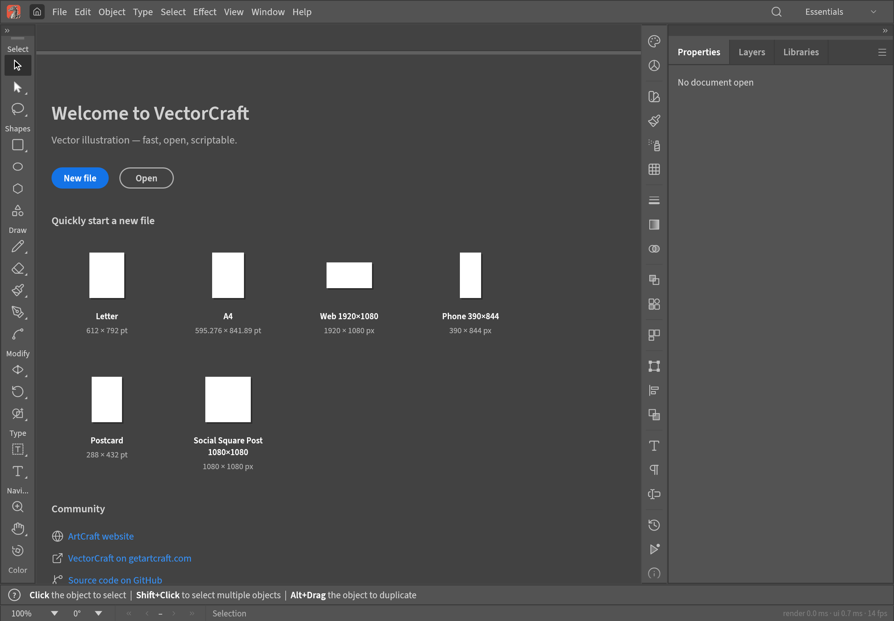

# VectorCraft for iPadOS (fork)

<p align="center">
  
  <br>
  <sub>VectorCraft on iPadOS, in landscape (iPad Air 11-inch simulator).</sub>
</p>

This fork exists only for the **iPadOS port** of VectorCraft, an open-source, clean-room vector
illustration app written in Rust. To learn about the project itself (features, file formats, desktop and
web builds, downloads, the other Crafting Apps, contributing), read the upstream README:
**[storytold/vectorcraft](https://github.com/storytold/vectorcraft#readme)**.

## What this fork adds

- **`apps/vectorcraft-ios`**: a Rust static-library runner (single UIKit window scene attached to winit's
  window, safe-area insets taken from UIKit every frame, UIDocumentPicker open and save services, saves
  that remember their destination, browser links, preferences and Data Recovery in the app container).
- **`packaging/ios`**: the Xcode project that links the library into an iPad app bundle, with a bundle
  validator and tests. See its [README](packaging/ios/README.md).
- **`cargo xtask ios`**: build, install and launch on the Simulator or a physical iPad
  (`--sim`, `--device --device-id <id> --team <id> [--bundle-id <dev id>]`).
- **Shared changes**: `Services::save_requires_worker` (saves and exports always run on the background
  worker, so the UI thread never waits for the export picker) and painted tool cursors on iPadOS.
- **No Discord links.** The Join Our Discord command, buttons, menu entries and strings are gone.

## Status

Verified in the iPad Air 11-inch M3 simulator (iPadOS 26.2): the app builds, installs, launches, renders
the editor in landscape and keeps the UI inside the safe area.

User-reported on a physical iPad Air 13-inch (M3), Debug build (2026-10-13), not instrumented: Open and
Save work through the Files picker, pinch to zoom works, and Apple Pencil input works.

Added in milestone 2 (iPadOS-6) and installed on the iPad, **not yet verified there**: two-finger pan and
rotation (pinch zooms about the fingers), Apple Pencil hover (the tool cursor follows the floating tip),
and palm rejection (a finger beside a hovering pen paints nothing). Host tests cover the gesture math, the
pen/finger bookkeeping and the canvas behaviour; the UIKit hover code has not run with a Pencil yet.

**Not yet verified:** Apple Pencil pressure (the tools tried did not use it), multitasking, Release
builds. Pencil tilt, barrel roll, double-tap and the eraser end are not read: no tool takes them yet. Folder picking and the system clipboard are not implemented
yet. This is a first bootstrap, not a hardware sign-off.

## Build and run

Requires macOS with Xcode and the Rust targets `aarch64-apple-ios`, `aarch64-apple-ios-sim` and
`x86_64-apple-ios`.

```sh
cargo xtask ios --sim          # build, boot, install and launch on the iPad simulator
cargo xtask ios --device --device-id <udid> --team <team id> --bundle-id <your.dev.bundle.id>
cargo test -p vectorcraft-ios --lib
python3 -m unittest discover -s packaging/ios/tests -v
```

Contributor rules (clean-room, never crash, layering, assets) are in [`AGENTS.md`](AGENTS.md).

## License and attribution

Dual-licensed MIT OR Apache-2.0, as upstream. Assets are listed in [`ASSETS.md`](ASSETS.md).
